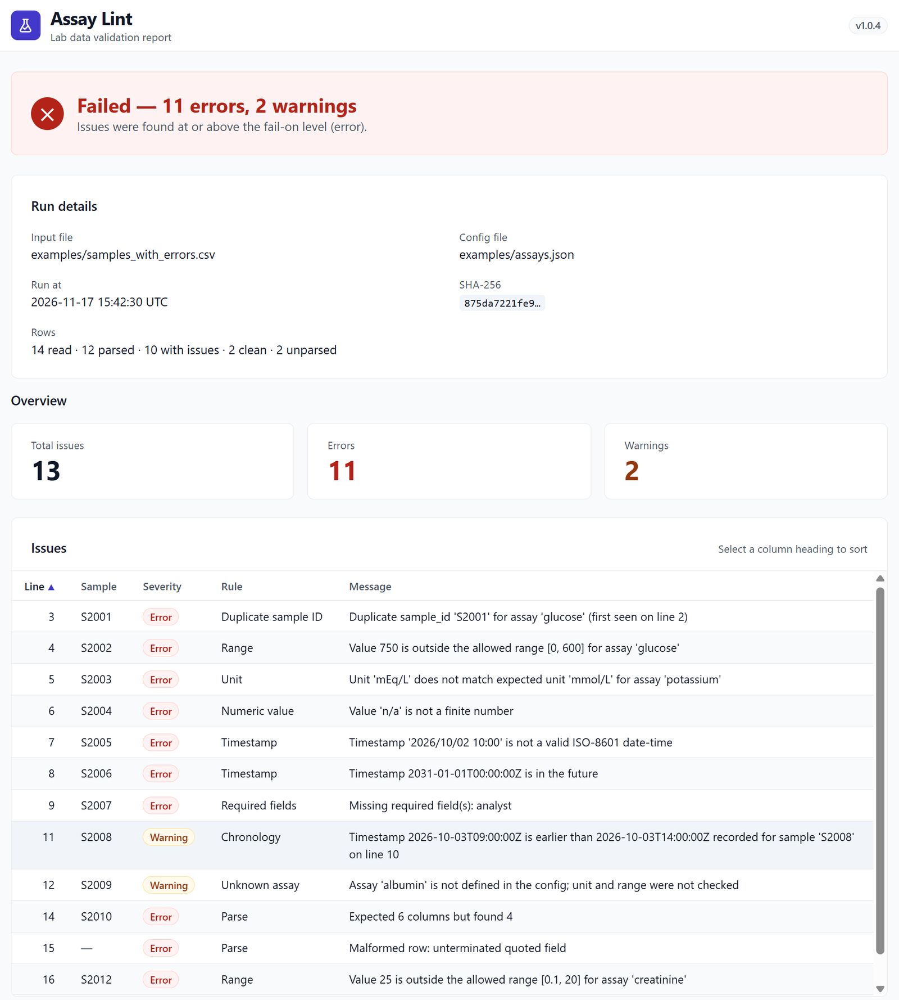

# assay-lint

[](https://github.com/mmk4567890/assay-lint/actions/workflows/ci.yml)

assay-lint is a command-line tool that checks laboratory sample data files (CSV) for data-integrity problems before they are loaded into a LIMS, ELN or other regulated system. It flags missing fields, duplicate results, non-numeric or out-of-range values, wrong units, invalid or future timestamps, out-of-order measurements and unknown assays, and reports each problem with its line number. Every report records the SHA-256 of the input, the config used and a UTC timestamp, so a result can be traced back to the exact file that was checked. Because the exit code reflects what was found, the same check can gate a CI pipeline or an automated data transfer.



## Quick start

Requires Java 17 and Maven.

```bash
mvn -B verify
```

```bash
java -jar target/assay-lint.jar validate examples/samples_with_errors.csv --config examples/assays.json
```

Output from that run (colors removed):

```text
assay-lint report
  Input:   examples\samples_with_errors.csv
  SHA-256: 875da7221fe9929b1158ac2741f65dfef055af4569eb346116f127250a78a754
  Config:  examples\assays.json
  Run at:  2026-11-16T17:48:41Z
  Rows:    14 read, 12 parsed (10 with issues, 2 clean), 2 could not be parsed

Summary: 13 issue(s)  11 error(s), 2 warning(s)
  Chronology         1
  DuplicateSampleId  1
  NumericValue       1
  Parse              2
  Range              2
  RequiredFields     1
  Timestamp          2
  Unit               2
  UnknownAssay       1

Line 3 (S2001)
  ERROR    DuplicateSampleId  Duplicate sample_id 'S2001' for assay 'glucose' (first seen on line 2)
Line 4 (S2002)
  ERROR    Range              Value 750 is outside the allowed range [0, 600] for assay 'glucose'
Line 5 (S2003)
  ERROR    Unit               Unit 'mEq/L' does not match expected unit 'mmol/L' for assay 'potassium'
Line 6 (S2004)
  ERROR    NumericValue       Value 'n/a' is not a finite number
Line 7 (S2005)
  ERROR    Timestamp          Timestamp '2026/10/02 10:00' is not a valid ISO-8601 date-time
Line 8 (S2006)
  ERROR    Timestamp          Timestamp 2031-01-01T00:00:00Z is in the future
Line 9 (S2007)
  ERROR    RequiredFields     Missing required field(s): analyst
Line 11 (S2008)
  WARNING  Chronology         Timestamp 2026-10-03T09:00:00Z is earlier than 2026-10-03T14:00:00Z recorded for sample 'S2008' on line 10
Line 12 (S2009)
  WARNING  UnknownAssay       Assay 'albumin' is not defined in the config; unit and range were not checked
Line 14 (S2010)
  ERROR    Parse              Expected 6 columns but found 4
Line 15
  ERROR    Parse              Malformed row: unterminated quoted field
Line 16 (S2012)
  ERROR    Range              Value 25 is outside the allowed range [0.1, 20] for assay 'creatinine'
  ERROR    Unit               Unit 'mg/dl' does not match expected unit 'mg/dL' for assay 'creatinine'
```

The command exits with code `1` because errors were found. Running it against `examples/samples_clean.csv` prints `No issues found.` and exits with `0`.

## Validating an instrument export

[`examples/instrument_export.csv`](examples/instrument_export.csv) is laid out like a real analyzer export. It has instrument and run IDs, a QC flag and free-text operator comments alongside the six required columns, in the analyzer's own column order. It also starts with a byte-order mark, uses Windows line endings, and has quoted comments that contain commas. The extra columns are skipped with a warning, and the run surfaces the four genuine problems in the data:

```bash
java -jar target/assay-lint.jar validate examples/instrument_export.csv --config examples/assays.json
```

```text
assay-lint report
  Input:   examples\instrument_export.csv
  SHA-256: 93b7846803aab67af0e9b48097927d70819c4478e76527023a3fa03f36c4fb09
  Config:  examples\assays.json
  Run at:  2026-11-16T17:48:41Z
  Rows:    25 read, 25 parsed (4 with issues, 21 clean), 0 could not be parsed

Summary: 8 issue(s)  4 error(s), 4 warning(s)
  DuplicateSampleId  1
  Parse              4
  Range              1
  Timestamp          1
  Unit               1

Line 1
  WARNING  Parse              Ignoring unknown column 'instrument_id'
  WARNING  Parse              Ignoring unknown column 'operator_comment'
  WARNING  Parse              Ignoring unknown column 'qc_flag'
  WARNING  Parse              Ignoring unknown column 'run_id'
Line 8 (P-1003)
  ERROR    Range              Value 11.2 is outside the allowed range [1.5, 10] for assay 'potassium'
Line 14 (P-1005)
  ERROR    Unit               Unit 'mEq/L' does not match expected unit 'mmol/L' for assay 'sodium'
Line 19 (P-1006)
  ERROR    DuplicateSampleId  Duplicate sample_id 'P-1006' for assay 'glucose' (first seen on line 17)
Line 25 (P-1008)
  ERROR    Timestamp          Timestamp 2031-03-01T08:31:15 is in the future
```

## Usage

```text
assay-lint validate <file.csv> --config <assays.json>
                    [--format console|json|html] [--out <path>]
                    [--no-color] [--fail-on warning|error]
```

| Option | Description |
|---|---|
| `<file.csv>` | Sample data file to validate. |
| `--config <assays.json>` | Assay definitions (required). |
| `--format <format>` | `console` (default), `json` or `html`. Case-insensitive. |
| `--out <path>` | Write the report to a file instead of stdout. Console output written to a file never contains color codes. |
| `--no-color` | Disable ANSI colors in console output. |
| `--fail-on <level>` | Lowest severity that causes exit code 1: `warning` or `error` (default `error`). |
| `-h`, `--help` | Show help. |

Example of producing an HTML report:

```bash
java -jar target/assay-lint.jar validate examples/samples_with_errors.csv --config examples/assays.json --format html --out report.html
```

The HTML report is a single file with inline CSS and no external assets. It contains the run details, summary counts and an issues table you can sort by clicking any column header.

### Exit codes

| Code | Meaning |
|---|---|
| `0` | No issues at or above the `--fail-on` level. |
| `1` | At least one issue at or above the `--fail-on` level. |
| `2` | Bad input: invalid arguments, a missing or unreadable input file, an invalid config, a file that is not comma-separated, or a header with a missing or duplicate required column. |

### Input format

The CSV must have the columns `sample_id`, `assay`, `value`, `unit`, `timestamp` and `analyst`.

- **Header.** The header may list the columns in any order, and names are matched case-insensitively. If the header is missing, the default column order is assumed and a warning is reported. Extra columns, such as a `comment` column from an instrument export, are skipped with a warning (`Ignoring unknown column 'comment'`), and every row must then have the same number of columns as the header. A header with a missing or duplicate required column stops the run with exit code `2`: without a reliable column mapping, no row can be read safely.
- **Fields and lines.** Fields may be quoted, which allows commas inside them, and `""` stands for a literal quote. Spaces or tabs before an opening quote or after a closing quote are ignored, so `jdoe, "Nguyen, T."` is two fields. Each line is one record, so a quoted field cannot span lines. Blank lines are ignored, and both LF and CRLF line endings work.
- **Malformed rows.** A row with the wrong number of columns or broken quoting is reported with its line number, and validation continues with the next row. A single trailing comma (one extra, empty last field) is ignored on both the header and data rows, so `...,jdoe,` reads the same as `...,jdoe`.
- **Timestamps.** They must be ISO-8601 date-times, such as `2026-10-01T08:15:00Z` or `2026-10-01T10:00:00+02:00`. A timestamp without an offset is read as UTC.

### Rules

| Rule | Severity | Checks |
|---|---|---|
| `Parse` | ERROR / WARNING | File structure: header, column count, quoting, empty file |
| `RequiredFields` | ERROR | No field is empty |
| `DuplicateSampleId` | ERROR | Each `sample_id` + `assay` pair appears only once |
| `NumericValue` | ERROR | `value` is a finite decimal number (`NaN`, `Infinity`, `1,5` are rejected) |
| `Range` | ERROR | `value` lies within the assay's `[min, max]`, inclusive |
| `Unit` | ERROR | `unit` exactly matches the assay's unit (case-sensitive, so `mg/dl` is not `mg/dL`) |
| `Timestamp` | ERROR | `timestamp` is a valid ISO-8601 date-time and not in the future |
| `Chronology` | WARNING | Each sample's timestamps appear in chronological order in the file |
| `UnknownAssay` | WARNING | `assay` is defined in the config |

A rule skips values that belong to another rule. For example, `Range` ignores a value that is not a number, because `NumericValue` already reports it. That way one bad cell produces one issue, not several.

## Config format

```json
{
  "assays": {
    "glucose":   { "unit": "mg/dL",  "min": 0,   "max": 600 },
    "potassium": { "unit": "mmol/L", "min": 1.5, "max": 10 }
  }
}
```

Each assay needs a non-empty `unit`, plus numeric `min` and `max` with `min <= max`. Assay names are matched exactly. Every problem in the config is reported at once with exit code `2`, for example:

```text
Error: Invalid config assays.json: assay 'ph': min (14) is greater than max (0)
```

See [`examples/assays.json`](examples/assays.json) for a six-assay config.

## Known limitations

- **Commas only.** Tab- and semicolon-separated files are not supported. If the first non-blank line has no commas but does have tabs or semicolons, the run stops with exit code `2` and asks you to save the file as comma-separated CSV.
- **No line breaks inside quoted fields.** Each physical line is one record. A quoted field that continues onto the next line is reported as a malformed row (unterminated quote), and the following line is read as a new record.
- **Timestamps without a time zone are read as UTC.** `2026-10-01T08:15:00` is treated as `2026-10-01T08:15:00Z`. If your instruments record local time, include the offset (for example `+02:00`) so the future and chronology checks compare the right instants.
- **Assay and unit names are case-sensitive.** `Glucose` is not the same assay as `glucose`, and `mg/dl` does not match `mg/dL`. Column names in the header are the exception: they are matched case-insensitively.

## Adding a new rule

1. Create a class in `com.mustafakhan.assaylint.rules` that implements `ValidationRule`. Return a short `name()`, and from `check(records, config)` return a `ValidationIssue` for each problem, using `ValidationIssue.of(record, name(), severity, message)`.
2. Skip blank fields and values another rule already reports, so each problem is reported once.
3. Add the rule to `RuleEngine.defaultRules(Clock)`.
4. Add a test class with passing and failing cases using small inline records, and update `examples/samples_with_errors.csv` so the new rule fires there too. `ExamplesTest` checks that every rule fires on that file.

## Design decisions

- **One class per rule.** Each check is small, independently tested and named in the report, so a reviewer can see exactly which rule raised an issue. Adding a rule never touches the others.
- **Config-driven assays.** Units and ranges live in JSON, not code. A lab can adjust limits or add an assay without a rebuild, and the config path is recorded in every report.
- **Injected `Clock`.** The future-timestamp check and the report's run time both read from a `Clock` passed in at startup. Tests pin "now", so they never become flaky as real time passes.
- **Exit codes for CI.** `0` / `1` / `2` separate "clean", "data problems" and "could not run". `--fail-on` lets a pipeline decide whether warnings block it. An unexpected failure exits with `2`, never `1`, so a crash can't pass for "issues found".
- **SHA-256 for traceability.** A report states which bytes were validated, not just a file name, so it stays meaningful after the file is moved or renamed. That is the kind of evidence data-integrity reviews (ALCOA+) ask for.
- **Minimal dependencies.** Only picocli (CLI parsing) and Jackson (JSON), with a small hand-written CSV parser. There are fewer libraries to audit and patch, and the fat jar runs anywhere Java 17 does.

## Tests and coverage

```bash
mvn verify
```

This runs the JUnit 5 suite and the JaCoCo coverage check, which fails the build if line coverage drops below 85%. To view the coverage report, open `target/site/jacoco/index.html` in a browser. CI runs the same `mvn -B verify` on every push and pull request.

## License

[MIT](LICENSE) © Mustafa Khan
